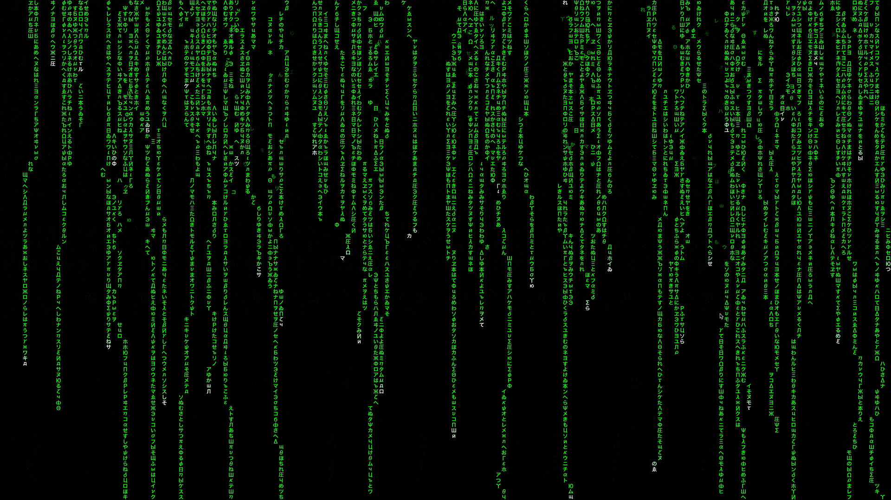

<p align="center">
  
</p>

<h1 align="center">MatrixSaver</h1>

<p align="center"><em>The Matrix digital rain as a real macOS screensaver — a modern ExtensionKit app extension for macOS 14 through 27.</em></p>

<p align="center">
  
  <a href="https://github.com/CelestialTech/MatrixSaver/releases/latest"></a>
  <a href="https://github.com/CelestialTech/MatrixSaver/releases"></a>
  
</p>

MatrixSaver is a native green digital-rain screensaver for macOS, built as a modern
ExtensionKit **`.appex`** — the same first-class format Apple's own screensavers
(Flurry, Drift, Computer Name…) use. That is what lets it register and run cleanly on
**macOS 26/27**, where the legacy `.saver` plug-in path has become unreliable. On-screen it
drives **Monroe Williams' Metal "Matrix"** renderer, forced onto its GPU Metal path and hosted
as the extension's principal view so it renders correctly — and at ~4% CPU — on **every**
display, including 2× Retina. An original CoreGraphics renderer is kept only as a load-failure
fallback; the picker thumbnail is a locked green tile (Monroe's Metal cannot draw offscreen).

## Contents

- [Install](#install) · [Uninstall](#uninstall) · [Requirements](#requirements)
- [How it works](#how-it-works) · [Building it as a modern .appex](#building-it-as-a-modern-appex)
- [Build from source](#build-from-source) · [Headless activation](#headless-activation-wallpaper-store)
- [Grid-tile thumbnail workaround](#grid-tile-thumbnail-workaround-macos-2627)
- [Credits & references](#credits--references) · [License](#license)

## Install

Download the two notarized packages from the
[**latest release**](https://github.com/CelestialTech/MatrixSaver/releases/latest):

| Package | Does |
|---|---|
| **`MatrixSaver-<v>.pkg`** | Installs / upgrades. Double-click and you are done. |
| **`MatrixSaver-Uninstall-<v>.pkg`** | Removes everything this installed (see [Uninstall](#uninstall)). |

The installer is **self-configuring** and **idempotent** (safe to re-run to upgrade) — it installs
`MatrixSaver.app` into your **`~/Applications`**, registers the extension, forces Monroe onto its
**Metal** renderer, **selects Matrix** as the screen saver, locks the green Matrix tile over the
picker's generic placeholder, and reloads the wallpaper agent. *(Optional)* open **System Settings →
Screen Saver** to confirm **Matrix** is selected.

Both packages are Developer-ID signed and notarized, so they install with no Gatekeeper prompt and
nothing is quarantined.

> **Why `~/Applications` and not `/Applications`?** The wallpaper store resolves the saver by an
> absolute path, and the macOS 26/27 picker writes its per-user caches against that path. A single
> per-user copy at `~/Applications` keeps the store reference, the `pluginkit` registration, and the
> thumbnail cache pointing at the same bundle — a split between `/Applications` and `~/Applications`
> is exactly what produces a dead reference and a placeholder tile.

## Uninstall

Run **`MatrixSaver-Uninstall-<v>.pkg`** (double-click). It is a payload-free notarized package whose
only job is a clean, precise reversal: it clears **only** the Matrix wallpaper Choice (any other
saver you had configured is left intact; the idle saver falls back to the system default),
deregisters the extension (`pluginkit -r`), unlocks and clears the locked thumbnail cache so tiles
regenerate, removes `~/Applications/MatrixSaver.app` **and the appex's sandbox container** (where the
Monroe renderer pref was written), forgets the install receipt, and reloads the wallpaper agent. Uninstall-via-`.pkg` is a first-class deliverable alongside
the installer — no manual Terminal steps required.

> **If you remove the app by dragging it to the Trash instead of running the uninstaller**, the two
> green thumbnail-cache PNGs the installer locked with `chflags uchg` are left behind (the lock is
> what stops macOS regenerating the generic swirl over the green tile). They're harmless, but the
> OS can't rewrite them until unlocked. Running the uninstaller `.pkg` clears them; by hand it's
> `chflags -R nouchg "$(getconf DARWIN_USER_CACHE_DIR)com.apple.wallpaper.extension.legacy/com.apple.wallpaper.legacy.thumbnails"`.

## Requirements

- **macOS 14–27** (Sonoma through the macOS 27 line).
- **Universal — Apple Silicon and Intel** (`arm64 + x86_64`). Our code, the host app, the
  `mxwallpaper` helper, and the bundled Monroe binary are all universal.
- **No interpreter dependency.** The installer carries no Python/CLT requirement — the wallpaper
  Choice is read/written by a compiled, signed helper shipped inside the app.
- To build from source: Xcode Command Line Tools (`clang`), and Monroe Williams'
  `Matrix.saver` (see [Build from source](#build-from-source) — it is not bundled in this repo).

## How it works

Three thin classes, reverse-engineered from Apple's ObjC `Computer Name.appex`:

| Class | Base (from `ScreenSaver.framework`) | Role |
|---|---|---|
| `MatrixExtension` | `ScreenSaverExtension` | principal class (intentionally minimal) |
| `MatrixViewController` | `ScreenSaverViewController` | makes Monroe's Metal view the **principal view**; forces renderer=Metal; falls back to CoreGraphics only if Monroe won't load |
| `MatrixView` | `ScreenSaverView` | the layer-backed CoreGraphics rain: `initWithFrame:isPreview:`, `animateOneFrame`, `drawRect:` |

`ScreenSaverExtension` and `ScreenSaverViewController` have no public headers but are
exported by `ScreenSaver.framework` (its `.tbd` lists them) — declare them locally
(`@interface X : NSObject` / `: NSViewController`) and link `-framework ScreenSaver`.
`ScreenSaverView` and `ScreenSaverDefaults` are public (`<ScreenSaver/ScreenSaver.h>`).

### Renderer strategy: Monroe's Metal as the principal view, forced onto Metal

The on-screen renderer is **Monroe Williams' Metal "Matrix"**, loaded at runtime from the bundled
`Contents/Resources/Matrix.saver`. Two things are required to make it render correctly and cheaply
on every display — both learned the hard way on a 2× Retina MacBook Air (2560×1664, macOS 27):

**1 — Monroe is the controller's _principal view_, not a subview.** WallpaperAgent hosts the
`.appex` out of process: `ScreenSaverViewController` is an `NSServiceViewController` (ViewBridge),
and the host composites the controller's `self.view` layer tree across the XPC boundary as a shared
**IOSurface**. A plain `NSView` container is not backed at the display's 2× scale, so a Retina panel
received a 1× surface and the saver was **black**. Making Monroe's Metal `ScreenSaverView` *be*
`self.view` (assigned in `-loadViewForFrame:isPreview:`, the private framework entry point that
hands over the true full-resolution frame) lets ViewBridge host it directly at the real backing
scale — the same reason the CoreGraphics fallback is layer-backed with a pinned `contentsScale`.
This is why it now renders on the 2× Air exactly as it always did on a 1× Mac Studio.

**2 — Monroe is forced onto Metal (`renderer = 0`) from inside the process.** Monroe defaults to an
**OpenGL** renderer, which on Apple Silicon / macOS 27 is CPU-emulated: **~90% CPU** and the flat,
depth-less "OpenGL" look. Metal uses the GPU: **~4% CPU** and the proper depth-shaded rain. Monroe
reads its `"renderer"` key via `-[ScreenSaverDefaults defaultsForModuleWithName:
@"org.indirect.screensaver.Matrix"]`, which resolves to **this `.appex`'s sandbox container** — so
an external `defaults write` is redirected by the sandbox and never seen. The controller sets it
**in-process, once, before Monroe builds its view**:

```objc
ScreenSaverDefaults *sd = [ScreenSaverDefaults defaultsForModuleWithName:@"org.indirect.screensaver.Matrix"];
[sd setInteger:0 forKey:@"renderer"];   // 0 = Metal, 1 = OpenGL
[sd synchronize];
```

> The `com.apple.security.temporary-exception.sbpl` entitlement that Apple's own savers carry is
> **Apple-only**: adding it to a third-party Developer-ID appex breaks the appex's I/O and does not
> help Metal (Metal is available without it). It is a dead end — do not add it.

The Monroe **bundle class** is loaded **once per process** and cached, and the renderer pref is
written once, so Tahoe's view-controller churn (the host re-instantiates the controller ~50×/min,
FB19204084) triggers no DYLD reload. Each on-screen controller builds its own Monroe Metal view as
its principal view and tears it down on `viewDidDisappear`, so churned instances cost nothing.

The CoreGraphics `MatrixView` is the **load-failure fallback** only (if Monroe's bundle cannot be
loaded). It is layer-backed (`makeBackingLayer` + `contentsScale` pinned to the backing scale) so it
too crosses the XPC boundary correctly on 2×, and it is **host-driven**: `SSENeedsAnimationTimer` is
`true`, so the host calls `-animateOneFrame` at the frame rate (a self-driven `NSTimer` gated on
`self.window` never fires in the windowless hosted extension — that was the original black screen).

**A non-obvious macOS 26/27 finding:** the System Settings *popover preview* and the *real
full-screen idle run* are the **same wallpaper-agent render path** — both on-screen, both at the
same observed window level (`-2147483625`), indistinguishable from inside the extension by size,
level, or occlusion. Both therefore get Monroe. Only the offscreen thumbnail snapshot cannot run
Monroe (Metal renders blank there), which is why the grid tile is a locked PNG, below.

## Building it as a modern .appex

The `Info.plist` keys that make the bundle a screensaver extension:

```
CFBundlePackageType = XPC!
NSExtension = {
    NSExtensionPointIdentifier = com.apple.screensaver
    NSExtensionPointVersion    = 1.0
    NSExtensionPrincipalClass  = MatrixExtension    # ObjC: no module prefix
}
ScreenSaverViewControllerClass = MatrixViewController
SSEHasConfigureSheet   = false
SSENeedsAnimationTimer = true     # host drives -animateOneFrame (the fallback needs it; Monroe self-drives)
```

### The extension must be sandboxed

A screensaver app extension **must be sandboxed**, or `pkd` silently refuses to bind it —
`pluginkit -a` returns 0, but `pluginkit -m -i <id>` shows nothing, and the log reads
`could not create extension point record … -10814`. The required entitlements
(`appex.entitlements`):

```
com.apple.security.app-sandbox                              = true
com.apple.security.cs.disable-library-validation            = true   # loads Monroe's bundle
com.apple.security.temporary-exception.mach-lookup.global-name =
    [ com.apple.CARenderServer, com.apple.CoreDisplay.master, com.apple.ViewBridgeAuxiliary ]
```

> Signing with a **stripped** entitlements file (app-sandbox only, missing
> `disable-library-validation` + the mach-lookup set) is a silent failure: Monroe's bundle will not
> load under the hardened runtime and you fall back to the CoreGraphics renderer. Both build scripts
> sign with `appex.entitlements`; there is no second, reduced entitlements file in the repo.

For distribution, sign with a **Developer ID** and the hardened runtime (`-o runtime`), applying
those entitlements to the extension, and sign the appex **before** the host app. Sign only **your
own** code: Monroe's `Matrix.saver` binary must be shipped byte-for-byte — re-signing it makes his
Metal renderer draw black. The build script asserts its md5 is unchanged across signing.

### Install location matters

The `.appex` ships inside a host app: `MatrixSaver.app/Contents/PlugIns/MatrixSaver.appex`.
Install it to **one** location and make sure the wallpaper store's bookmark resolves to it.
A mismatch fails silently: if the copy registered with `pluginkit` is not the copy the store's
`Idle` config points to, the reference is dead — the `screenSaver-` cache directory gets an
empty suffix and the picker shows a placeholder tile. The release `.pkg` installs a single
per-user copy to **`~/Applications`**; don't leave stragglers in `/Applications` or DerivedData.
Register and verify:

```bash
lsregister -f ~/Applications/MatrixSaver.app
pluginkit -a ~/Applications/MatrixSaver.app/Contents/PlugIns/MatrixSaver.appex
pluginkit -m -i io.celestialtech.MatrixSaver.saver   # lists it, SDK = com.apple.screensaver
```

## Build from source

> **Monroe Williams' `Matrix.saver` is not included in this repository.** Obtain it (see
> [Credits](#credits--references)) and place it at
> `Matrix.saver/` in the repo root; the build scripts stage it into the appex at
> `…/MatrixSaver.appex/Contents/Resources/Matrix.saver`.
> Without it the on-screen renderer will not load and you get the CoreGraphics fallback only.

Two builders ship in the repo:

```bash
./build.sh                 # ad-hoc, local arm64 build: assembles the bundles, ad-hoc signs,
                           # installs to ~/Applications, and registers via pluginkit
./build-pkg-notarize.sh    # the distributable: compiles UNIVERSAL (arm64+x86_64), signs ONLY your
                           # code (asserts Monroe's sha256 before and after), builds BOTH the
                           # installer and uninstaller Developer-ID .pkgs, notarizes + staples
```

`build.sh` produces an **ad-hoc, local** build. For distributable artifacts use
`build-pkg-notarize.sh`, which:

1. **Compiles** `MatrixView.m` + `MatrixSaver.m` (**universal `arm64 + x86_64`**, frameworks
   ScreenSaver / AppKit / Foundation / QuartzCore / Metal, entry `_NSExtensionMain`), the tiny host
   app, and the **`mxwallpaper`** helper (a Foundation-only tool that reads/writes the wallpaper
   Choice — so the installer needs **no `/usr/bin/python3`**, which a clean Mac may lack).
2. **Stages `Matrix.saver`** into the appex's `Contents/Resources` and **asserts its sha256 is
   unchanged** before and after signing, and that it is the only Mach-O in `MacOS/` (a FATAL guard —
   re-signing Monroe's binary renders black).
3. **Signs only your code** with `appex.entitlements`, `-o runtime --timestamp` Developer ID — the
   appex binary and bundle, the `mxwallpaper` helper, then the host app (helper before the main
   executable, so the bundle seals cleanly without `--deep`, which would re-sign Monroe).
4. Builds a **non-relocatable installer `.pkg`** (`--component-plist` with
   `BundleIsRelocatable=false`) whose `postinstall` installs to `~/Applications`, registers the appex
   (**retrying until `pluginkit` confirms**), selects Matrix via the helper and **verifies it stuck**,
   runs the one-shot tile fix, and reloads `WallpaperAgent` — and **exits non-zero if registration or
   the Choice fails**, so a broken install surfaces as an installer error, not a silent success. Plus
   a **payload-free uninstaller `.pkg`** that precisely reverses it.
5. **Notarizes + staples** both so they install with no Gatekeeper prompt.

> **Forcing Monroe's Metal renderer is done in code, not by `defaults`.** The controller writes
> `renderer = 0` through `ScreenSaverDefaults` *inside the sandboxed appex* (see
> [Renderer strategy](#renderer-strategy-monroes-metal-as-the-principal-view-forced-onto-metal)).
> An external `defaults -currentHost write org.indirect.screensaver.Matrix renderer -int 0` does
> **not** reach the appex — the sandbox redirects it to a different container.

## Headless activation (wallpaper store)

The installer does this for you. To set it by hand without the UI, write the
`com.apple.wallpaper` store at
`~/Library/Application Support/com.apple.wallpaper/Store/Index.plist`. Set every `Idle` scope
(`AllSpacesAndDisplays.Idle` and each `Displays[*].Idle`) to:

```python
cfg = plistlib.dumps({"module": {"relative":
      "file://" + os.path.expanduser(
        "~/Applications/MatrixSaver.app/Contents/PlugIns/MatrixSaver.appex")}},
      fmt=plistlib.FMT_BINARY)
idle = {"Content": {"Choices": [{"Configuration": cfg, "Files": [],
        "Provider": "com.apple.wallpaper.choice.screen-saver"}]},
        "LastSet": now, "LastUse": now}
```

then `killall WallpaperAgent`. The shape matches the PaperSaver library —
`{module: {relative: <file:// URL>}}` with provider `com.apple.wallpaper.choice.screen-saver`.
Note that on macOS 26/27 the `com.apple.wallpaper.choice.screen-saver` provider is what selects
the saver; the older `moduleDict` default is ignored. The real idle saver on 26/27 runs through
`WallpaperAgent` (`ScreenSaverEngine` is a stub, and `open -a`/`osascript` do not force it
full-screen); the full-screen idle saver is a lock-screen feature, so desktop idle no longer starts
it automatically.

## Grid-tile thumbnail workaround (macOS 26/27)

The large popover preview renders live and works (see
[Renderer strategy](#renderer-strategy-monroes-metal-as-the-principal-view-forced-onto-metal)).
The small **grid tile** does not: on macOS 26/27 the picker never renders a third-party saver for
its tile — it routes the request through the legacy thumbnail generator, which cannot render a
modern `.appex` and emits a generic **blue-swirl placeholder**. No cache-clear, version bump,
or re-registration dislodges it, and `ScreenSaver.framework` exposes no thumbnail/poster hook.

The installer applies this automatically; by hand it replaces the picker's cached tile PNGs with a
static Matrix poster (Monroe ships one: `Matrix.saver/Contents/Resources/thumbnail.png`, green rain)
and locks them so they can't be regenerated:

```bash
T="$(getconf DARWIN_USER_CACHE_DIR)com.apple.wallpaper.extension.legacy/com.apple.wallpaper.legacy.thumbnails"
# Delete Matrix's blue-swirl PNGs and reopen the picker; the two that regenerate are Matrix's
# (one 214-wide, one 180-wide — the hashes are per-machine). Then overwrite and lock them:
chflags nouchg "$T"/<matrix-hash>.png
cat green_214.png > "$T"/<214-hash>.png      # green thumbnail.png, resized
cat green_180.png > "$T"/<180-hash>.png      # green thumbnail.png at 180 wide
chflags uchg "$T"/<matrix-hash>.png          # lock so the picker can't overwrite
```

The uninstaller reverses this (`chflags -R nouchg` + clear the cache so the swirl regenerates).
Because it overwrites a system cache and sets the immutable flag, the installer runs it one-shot —
nothing keeps running in the background (shipping it as a LaunchAgent would clutter Login Items).

## Credits & references

- **On-screen renderer — © Monroe Williams.** The on-screen digital rain is Monroe
  Williams' Metal "Matrix" screensaver (`org.indirect.screensaver.Matrix`), bundled in the
  release at `Contents/Resources/Matrix.saver` (its `thumbnail.png` also backs the grid tile).
  It is shipped byte-for-byte and never re-signed. **This is a third-party work, redistributed
  under its own terms — it is not covered by this project's license, and all credit for that
  renderer is his.**
- **CoreGraphics `MatrixView` fallback renderer, ExtensionKit packaging, and build/install
  tooling** — original to this project.
- **References** — Apple's `Computer Name.appex` (the ObjC blueprint), and the Aerial team's
  `AppexSaverMinimal` and `PaperSaver` (the entitlements set and the wallpaper-store config
  shape).

## License

This project ships no `LICENSE` file; the original code is provided as-is, all rights reserved.
Monroe Williams' bundled `Matrix.saver` is a third-party work under its own terms — see
[Credits](#credits--references).
