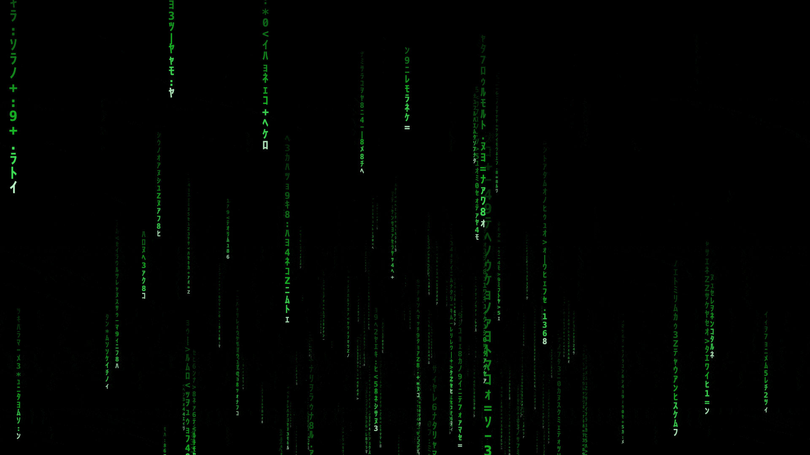

<p align="center">
  
</p>

<h1 align="center">MatrixSaver</h1>

<p align="center"><em>The Matrix digital rain as a real macOS screensaver — a modern ExtensionKit app extension for macOS 14 through 27.</em></p>

<p align="center">
  
  <a href="https://github.com/CelestialTech/MatrixSaver/releases/latest"></a>
  <a href="https://github.com/CelestialTech/MatrixSaver/releases"></a>
  
</p>

MatrixSaver is a native green digital-rain screensaver for macOS, built as a modern
ExtensionKit **`.appex`** — the same first-class format Apple's own screensavers
(Flurry, Drift, Computer Name…) use. That is what lets it register and run cleanly on
**macOS 26/27**, where the legacy `.saver` plug-in path has become unreliable. On-screen it
drives **Monroe Williams' Metal "Matrix"** renderer — which is resolution-independent and
cheap on every display; an original CoreGraphics renderer is kept strictly for the picker
thumbnail (which Monroe's Metal cannot draw) and as a fallback if Monroe fails to load.

## Contents

- [Install](#install) · [Requirements](#requirements)
- [How it works](#how-it-works) · [Building it as a modern .appex](#building-it-as-a-modern-appex)
- [Build from source](#build-from-source) · [Headless activation](#headless-activation-wallpaper-store)
- [Grid-tile thumbnail workaround](#grid-tile-thumbnail-workaround-macos-2627) · [Uninstall](#uninstall)
- [Credits & references](#credits--references) · [License](#license)

## Install

Download the notarized installer from the
[**latest release**](https://github.com/CelestialTech/MatrixSaver/releases/latest) and run it:

1. Run **`MatrixSaver.pkg`** (double-click).
2. That is all. The installer is **self-configuring** — it installs `MatrixSaver.app` into your
   **`~/Applications`**, registers the extension, **selects Matrix** as the screen saver, locks
   the green Matrix tile over the picker's generic placeholder, and reloads the wallpaper agent.
3. *(Optional)* Open **System Settings → Screen Saver** to confirm **Matrix** is selected.

Signed and notarized, so it installs with no Gatekeeper prompt and nothing is quarantined.

> **Why `~/Applications` and not `/Applications`?** The wallpaper store resolves the saver by an
> absolute path, and the macOS 26/27 picker writes its per-user caches against that path. A single
> per-user copy at `~/Applications` keeps the store reference, the `pluginkit` registration, and the
> thumbnail cache pointing at the same bundle — a split between `/Applications` and `~/Applications`
> is exactly what produces a dead reference and a placeholder tile.

## Requirements

- **macOS 14–27** (Sonoma through the macOS 27 line).
- **Apple Silicon (arm64).** The release binary and the build scripts compile `-arch arm64` only;
  Intel Macs need a universal rebuild.
- To build from source: Xcode Command Line Tools (`clang`), and Monroe Williams'
  `Matrix.saver` (see [Build from source](#build-from-source) — it is not bundled in this repo).

## How it works

Three thin classes, reverse-engineered from Apple's ObjC `Computer Name.appex`:

| Class | Base (from `ScreenSaver.framework`) | Role |
|---|---|---|
| `MatrixExtension` | `ScreenSaverExtension` | principal class (intentionally minimal) |
| `MatrixViewController` | `ScreenSaverViewController` | owns the Monroe Metal view on-screen; falls back to CoreGraphics (below) |
| `MatrixView` | `ScreenSaverView` | the CoreGraphics rain: `initWithFrame:isPreview:`, `animateOneFrame`, `drawRect:` |

`ScreenSaverExtension` and `ScreenSaverViewController` have no public headers but are
exported by `ScreenSaver.framework` (its `.tbd` lists them) — declare them locally
(`@interface X : NSObject` / `: NSViewController`) and link `-framework ScreenSaver`.
`ScreenSaverView` is public (`<ScreenSaver/ScreenSaver.h>`).

### Renderer strategy: Monroe's Metal on-screen, CoreGraphics for the thumbnail only

The on-screen renderer is **Monroe Williams' Metal "Matrix"**, loaded at runtime from the
bundled `Contents/Resources/Matrix.saver`. Monroe's `MTKView` cannot draw into the offscreen
bitmap context the system uses for thumbnail snapshots — it renders blank there — so the
CoreGraphics `MatrixView` exists to cover that one case (and as a fallback if Monroe's bundle
fails to load). `MatrixViewController` therefore builds Monroe's view for any on-screen host and
keeps CoreGraphics off the on-screen path entirely:

- **`viewDidAppear`** fires only for an on-screen host — never for the offscreen snapshot — and
  adds a Monroe Metal view sized to the host. Each controller renders its **own** Monroe view;
  the Monroe *bundle class* is loaded **once per process** and cached, so no host churn triggers a
  DYLD reload.
- **`viewDidDisappear`** tears that Monroe view back down.
- **`MatrixView`** (CoreGraphics) drives its own `NSTimer` and gates it to `window != nil`
  (`viewDidMoveToWindow`), so an offscreen thumbnail snapshot draws a single frame with no running
  timer, and a churned/accumulated controller that was never placed on-screen burns zero CPU.
  `SSENeedsAnimationTimer` is therefore `false`.

**Why this split matters (the PaiMei-vs-DIMAS story).** Monroe's Metal renderer is
GPU-/resolution-independent: measured at **3–4% CPU rendering full-screen even on a 2× Retina
MacBook Air (2560×1664)**. The CoreGraphics renderer, by contrast, is CPU-bound glyph
rasterization (`CGContextShowGlyphsWithAdvances`) whose cost scales with the pixel count — roughly
**4× heavier on a 2× Retina laptop than on a 1× 1080p desktop**. An earlier version let the
CoreGraphics path run on-screen; it was invisible on a 1× Mac Studio but spiked to 34–52% CPU and
flickered on the 2× Air. The fix was not to optimize CoreGraphics — it was to keep Monroe's Metal
on-screen and confine CoreGraphics to the offscreen thumbnail. (The CoreGraphics path was also
rewritten to drop a per-frame `malloc` and an O(n²) depth sort in favour of a persistent buffer +
`qsort` with cached glyph metrics, so even the thumbnail draw does no quadratic work.)

**A non-obvious macOS 26/27 finding:** the System Settings *popover preview* and the *real
full-screen idle run* are the **same wallpaper-agent render path** — both on-screen, both at the
same observed window level (`-2147483625`), indistinguishable from inside the extension by size,
level, or occlusion. Both therefore get Monroe. The preview reads blue-tinted only because of the
popover's translucent material; the real saver is green. Only the offscreen thumbnail snapshot
stays on CoreGraphics.

## Building it as a modern .appex

The `Info.plist` keys that make the bundle a screensaver extension:

```
CFBundlePackageType = XPC!
NSExtension = {
    NSExtensionPointIdentifier = com.apple.screensaver
    NSExtensionPointVersion    = 1.0
    NSExtensionPrincipalClass  = MatrixExtension    # ObjC: no module prefix
}
ScreenSaverViewControllerClass = MatrixViewController
SSEHasConfigureSheet   = false
SSENeedsAnimationTimer = false    # MatrixView drives its own window-gated NSTimer
```

### The extension must be sandboxed

A screensaver app extension **must be sandboxed**, or `pkd` silently refuses to bind it —
`pluginkit -a` returns 0, but `pluginkit -m -i <id>` shows nothing, and the log reads
`could not create extension point record … -10814`. The required entitlements
(`appex.entitlements`):

```
com.apple.security.app-sandbox                              = true
com.apple.security.cs.disable-library-validation            = true   # loads Monroe's bundle
com.apple.security.temporary-exception.mach-lookup.global-name =
    [ com.apple.CARenderServer, com.apple.CoreDisplay.master, com.apple.ViewBridgeAuxiliary ]
```

For distribution, sign with a **Developer ID** and the hardened runtime (`-o runtime`), applying
those entitlements to the extension, and sign the appex **before** the host app. Sign only **your
own** code: Monroe's `Matrix.saver` binary must be shipped byte-for-byte — re-signing it makes his
Metal renderer draw black.

### Install location matters

The `.appex` ships inside a host app: `MatrixSaver.app/Contents/PlugIns/MatrixSaver.appex`.
Install it to **one** location and make sure the wallpaper store's bookmark resolves to it.
A mismatch fails silently: if the copy registered with `pluginkit` is not the copy the store's
`Idle` config points to, the reference is dead — the `screenSaver-` cache directory gets an
empty suffix and the picker shows a placeholder tile. The release `.pkg` installs a single
per-user copy to **`~/Applications`**; don't leave stragglers in `/Applications` or DerivedData.
Register and verify:

```bash
lsregister -f ~/Applications/MatrixSaver.app
pluginkit -a ~/Applications/MatrixSaver.app/Contents/PlugIns/MatrixSaver.appex
pluginkit -m -i io.celestialtech.MatrixSaver.saver   # lists it, SDK = com.apple.screensaver
```

## Build from source

> **Monroe Williams' `Matrix.saver` is not included in this repository.** Obtain it (see
> [Credits](#credits--references)) and place it at
> `Matrix.saver/` in the repo root; the build scripts stage it into the appex at
> `…/MatrixSaver.appex/Contents/Resources/Matrix.saver`.
> Without it the on-screen renderer will not load and you get the CoreGraphics rain only.

Two builders ship in the repo:

```bash
./build.sh                 # ad-hoc, local arm64 build: assembles the bundles, ad-hoc signs,
                           # installs to ~/Applications, and registers via pluginkit
./build-pkg-notarize.sh    # the distributable: compiles arm64, signs ONLY your code
                           # (asserts Monroe's md5 before and after), builds a self-configuring
                           # Developer-ID .pkg, notarizes with notarytool, and staples
```

`build.sh` produces an **ad-hoc, local** build. For a distributable artifact use
`build-pkg-notarize.sh`, which additionally:

1. **Stages `Matrix.saver`** into the appex's `Contents/Resources` (above) and **asserts its md5 is
   unchanged** before and after signing (a FATAL guard — re-signing Monroe's binary renders black).
2. **Signs only your code** — the appex binary and bundle (with the sandbox entitlement) and the
   host app — with `-o runtime --timestamp` Developer ID, then builds a **non-relocatable** `.pkg`
   (`--component-plist` with `BundleIsRelocatable=false`) whose `postinstall` installs to
   `~/Applications`, selects Matrix, runs the one-shot tile fix, and reloads `WallpaperAgent`.
3. **Notarizes + staples** so the `.pkg` installs with no Gatekeeper prompt.

> **Forcing Monroe's Metal renderer.** Monroe's saver historically defaulted to an OpenGL path that
> renders black on macOS 26/27. Select Metal via its per-host preference if needed:
> ```bash
> defaults -currentHost write org.indirect.screensaver.Matrix renderer -int 0   # 0 = Metal, 1 = OpenGL
> ```

## Headless activation (wallpaper store)

The installer does this for you. To set it by hand without the UI, write the
`com.apple.wallpaper` store at
`~/Library/Application Support/com.apple.wallpaper/Store/Index.plist`. Set every `Idle` scope
(`AllSpacesAndDisplays.Idle` and each `Displays[*].Idle`) to:

```python
cfg = plistlib.dumps({"module": {"relative":
      "file://" + os.path.expanduser(
        "~/Applications/MatrixSaver.app/Contents/PlugIns/MatrixSaver.appex")}},
      fmt=plistlib.FMT_BINARY)
idle = {"Content": {"Choices": [{"Configuration": cfg, "Files": [],
        "Provider": "com.apple.wallpaper.choice.screen-saver"}]},
        "LastSet": now, "LastUse": now}
```

then `killall WallpaperAgent`. The shape matches the PaperSaver library —
`{module: {relative: <file:// URL>}}` with provider `com.apple.wallpaper.choice.screen-saver`.
Note that on macOS 26/27 the `com.apple.wallpaper.choice.screen-saver` provider is what selects
the saver; the older `moduleDict` default is ignored. The real idle saver on 26/27 runs through
`WallpaperAgent` (`ScreenSaverEngine` is a stub, and `open -a`/`osascript` do not force it
full-screen); the full-screen idle saver is a lock-screen feature, so desktop idle no longer starts
it automatically.

## Grid-tile thumbnail workaround (macOS 26/27)

The large popover preview renders live and works (see
[Renderer strategy](#renderer-strategy-monroes-metal-on-screen-coregraphics-for-the-thumbnail-only)).
The small **grid tile** does not: on macOS 26/27 the picker never renders a third-party saver for
its tile — it routes the request through the legacy thumbnail generator, which cannot render a
modern `.appex` and emits a generic **blue-swirl placeholder**. No cache-clear, version bump,
or re-registration dislodges it, and `ScreenSaver.framework` exposes no thumbnail/poster hook.

The installer applies this automatically; by hand it replaces the picker's cached tile PNGs with a
static Matrix poster (Monroe ships one: `Matrix.saver/Contents/Resources/thumbnail.png`, green rain)
and locks them so they can't be regenerated:

```bash
T="$(getconf DARWIN_USER_CACHE_DIR)com.apple.wallpaper.extension.legacy/com.apple.wallpaper.legacy.thumbnails"
# Delete Matrix's blue-swirl PNGs and reopen the picker; the two that regenerate are Matrix's
# (one 107x65, one 90x58 — the hashes are per-machine). Then overwrite and lock them:
chflags nouchg "$T"/<matrix-hash>.png
cat green_107x65.png > "$T"/<107x65-hash>.png      # green thumbnail.png, resized
cat green_90x58.png  > "$T"/<90x58-hash>.png       # green thumbnail.png at 90x58
chflags uchg "$T"/<matrix-hash>.png                # lock so the picker can't overwrite
```

This is reversible (`chflags nouchg` + delete regenerates the swirl). Because it overwrites a
system cache and sets the immutable flag, run it only when you intend to. It is one-shot — nothing
keeps running in the background (shipping it as a LaunchAgent would clutter Login Items).

## Uninstall

```bash
# 1. System Settings → Screen Saver → choose another saver (releases the store reference).
# 2. Deregister and remove the app:
pluginkit -r ~/Applications/MatrixSaver.app/Contents/PlugIns/MatrixSaver.appex
rm -rf ~/Applications/MatrixSaver.app
killall WallpaperAgent
# 3. If the thumbnail workaround was applied, unlock the cached PNGs first:
#    chflags nouchg "$(getconf DARWIN_USER_CACHE_DIR)com.apple.wallpaper.extension.legacy/com.apple.wallpaper.legacy.thumbnails"/*.png
```

## Credits & references

- **On-screen renderer — © Monroe Williams.** The on-screen digital rain is Monroe
  Williams' Metal "Matrix" screensaver (`org.indirect.screensaver.Matrix`), bundled in the
  release at `Contents/Resources/Matrix.saver` (its `thumbnail.png` also backs the grid tile).
  It is shipped byte-for-byte and never re-signed. **This is a third-party work, redistributed
  under its own terms — it is not covered by this project's license, and all credit for that
  renderer is his.**
- **CoreGraphics `MatrixView` renderer, ExtensionKit packaging, and build/install tooling** —
  original to this project.
- **References** — Apple's `Computer Name.appex` (the ObjC blueprint), and the Aerial team's
  `AppexSaverMinimal` and `PaperSaver` (the entitlements set and the wallpaper-store config
  shape).

## License

This project ships no `LICENSE` file; the original code is provided as-is, all rights reserved.
Monroe Williams' bundled `Matrix.saver` is a third-party work under its own terms — see
[Credits](#credits--references).
